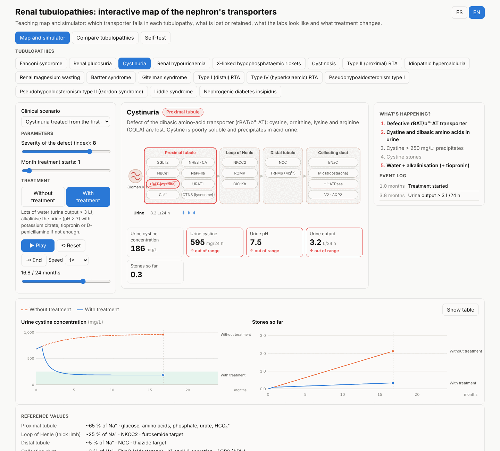

# Renal tubulopathies: an interactive map of the nephron

**Tubulopatías renales: mapa interactivo de los transportadores de la nefrona** — interactive teaching simulator (Spanish / English).

**Live demo:** https://ferasmed-dev.github.io/renal-tubulopathies/ · English: https://ferasmed-dev.github.io/renal-tubulopathies/?lang=en



The nephron laid out from glomerulus to collecting duct with every transporter a tubulopathy can break (SGLT2, NHE3, NBCe1, NaPi-IIa, rBAT, URAT1, CTNS, NKCC2, ROMK, ClC-Kb, NCC, TRPM6, ENaC, MR, H⁺-ATPase, V2/AQP2). Pick a tubulopathy and the failing transporter is crossed out (loss of function) or flagged ↑ (gain of function); the labs, urine output and stones then evolve over two years with or without treatment.

## What it shows

| Segment | Tubulopathies | Treatment arm |
|---|---|---|
| Proximal tubule | Fanconi syndrome, renal glucosuria, cystinuria, renal hypouricaemia, X-linked hypophosphataemic rickets, cystinosis, type II RTA, idiopathic hypercalciuria | replacement, fluids + alkali, phosphate + calcitriol, cysteamine, thiazide (glucosuria: none) |
| Loop of Henle | Bartter syndrome | K⁺ + NSAID + aldosterone antagonist |
| Distal tubule | Gitelman syndrome, Gordon syndrome (PHA II), renal Mg²⁺ wasting | K⁺ + Mg²⁺, thiazide, Mg²⁺ |
| Collecting duct | type I RTA, type IV RTA, PHA type I, Liddle syndrome, nephrogenic DI | K citrate, K control ± fludrocortisone, salt, amiloride, thiazide + diet |

Every entity offers:

- a **schematic** that shows the mechanism live and highlights where the disorder acts;
- **sliders and choices** for the parameters that drive it;
- a **sin / con tratamiento** (without / with treatment) comparison drawn on the same chart (dashed = without, solid = with);
- a **"¿Qué está pasando?"** panel that lights up each step of the mechanism as it happens, plus an **event log**;
- gauges with reference ranges, a **data-table view** of every chart, a **compare** tab with all entities side by side and a **self-test** tab.

## Curriculum fit

For students and teachers at any Spanish medical faculty.

- **Module (Orden ECI/332/2008):** Módulo III, *Formación clínica humana* (with support from Módulo II for physiology and pathology).
- **Typical subjects:** Fisiología (renal transport), Fisiopatología, Patología médica / Nefrología, Pediatría, Farmacología (diuretic targets).
- **MIR:** recurrent (Bartter vs Gitelman vs Liddle, RTA types, Fanconi, cystinuria, nephrogenic DI).

## For teachers

Every scenario has a deep link you can project or share. Add `&lang=en` for English.

| Preset | Scenario (EN) | Expected result | Link |
|---|---|---|---|
| `fanconi_tenofovir` | Tenofovir-induced Fanconi | HCO₃ 17, phosphate 2.0, glucosuria; replacement → HCO₃ 22, phosphate 3.1 (glucosuria persists) | [ES](https://ferasmed-dev.github.io/renal-tubulopathies/?preset=fanconi_tenofovir) · [EN](https://ferasmed-dev.github.io/renal-tubulopathies/?preset=fanconi_tenofovir&lang=en) |
| `glucosuria_casual` | Glucosuria on a routine test | Glucosuria ~10 g/day, everything else normal; no treatment arm | [ES](https://ferasmed-dev.github.io/renal-tubulopathies/?preset=glucosuria_casual) · [EN](https://ferasmed-dev.github.io/renal-tubulopathies/?preset=glucosuria_casual&lang=en) |
| `cistinuria_joven` | Cystinuria treated from the first colic | Cystine 960 mg/L and 3 stones in 2 years untreated; fluids + alkali → 186 mg/L, 0.4 stones | [ES](https://ferasmed-dev.github.io/renal-tubulopathies/?preset=cistinuria_joven) · [EN](https://ferasmed-dev.github.io/renal-tubulopathies/?preset=cistinuria_joven&lang=en) |
| `cistinuria_tardia` | Cystinuria treated after a year | First stone at month 8; treating at month 12 ends with 1.7 stones | [ES](https://ferasmed-dev.github.io/renal-tubulopathies/?preset=cistinuria_tardia) · [EN](https://ferasmed-dev.github.io/renal-tubulopathies/?preset=cistinuria_tardia&lang=en) |
| `hipouricemia_ejercicio` | Hypouricaemia and AKI after exercise | Urate 1.1 mg/dL; stones 1.1 → 0.4 with fluids + alkali | [ES](https://ferasmed-dev.github.io/renal-tubulopathies/?preset=hipouricemia_ejercicio) · [EN](https://ferasmed-dev.github.io/renal-tubulopathies/?preset=hipouricemia_ejercicio&lang=en) |
| `raquitismo_nino` | Child with bowed legs | Phosphate 1.4, bone index 2.8 untreated; phosphate + calcitriol → 2.8 and 1.0 | [ES](https://ferasmed-dev.github.io/renal-tubulopathies/?preset=raquitismo_nino) · [EN](https://ferasmed-dev.github.io/renal-tubulopathies/?preset=raquitismo_nino&lang=en) |
| `cistinosis_lactante` | Cystinosis with early cysteamine | GFR 100 → 77 in 2 years untreated vs 94 with cysteamine | [ES](https://ferasmed-dev.github.io/renal-tubulopathies/?preset=cistinosis_lactante) · [EN](https://ferasmed-dev.github.io/renal-tubulopathies/?preset=cistinosis_lactante&lang=en) |
| `cistinosis_sin_cisteamina` | Cystinosis without cysteamine | Cysteamine only at month 18: GFR 82 | [ES](https://ferasmed-dev.github.io/renal-tubulopathies/?preset=cistinosis_sin_cisteamina) · [EN](https://ferasmed-dev.github.io/renal-tubulopathies/?preset=cistinosis_sin_cisteamina&lang=en) |
| `atr2_aislada` | Isolated proximal RTA | HCO₃ 17, K 3.3, urine pH < 5.5; high-dose alkali → 22 | [ES](https://ferasmed-dev.github.io/renal-tubulopathies/?preset=atr2_aislada) · [EN](https://ferasmed-dev.github.io/renal-tubulopathies/?preset=atr2_aislada&lang=en) |
| `hipercalciuria_litiasis` | Recurrent calcium stones | Urine Ca 5.9 mg/kg/day, 2.2 stones; thiazide → 3.4 and 0.7 | [ES](https://ferasmed-dev.github.io/renal-tubulopathies/?preset=hipercalciuria_litiasis) · [EN](https://ferasmed-dev.github.io/renal-tubulopathies/?preset=hipercalciuria_litiasis&lang=en) |
| `hipomg_tetania` | Tetany from hypomagnesaemia | Mg 0.8, Ca 7.6; Mg salts → 1.5 and 8.8 | [ES](https://ferasmed-dev.github.io/renal-tubulopathies/?preset=hipomg_tetania) · [EN](https://ferasmed-dev.github.io/renal-tubulopathies/?preset=hipomg_tetania&lang=en) |
| `bartter_neonatal` | Neonatal Bartter | K 1.9, HCO₃ 34, polyuria, nephrocalcinosis; treatment → K 3.2 | [ES](https://ferasmed-dev.github.io/renal-tubulopathies/?preset=bartter_neonatal) · [EN](https://ferasmed-dev.github.io/renal-tubulopathies/?preset=bartter_neonatal&lang=en) |
| `gitelman_calambres` | Adult with cramps (Gitelman) | K 2.9, Mg 1.2, low urine Ca; K + Mg → 3.6 and 1.6 | [ES](https://ferasmed-dev.github.io/renal-tubulopathies/?preset=gitelman_calambres) · [EN](https://ferasmed-dev.github.io/renal-tubulopathies/?preset=gitelman_calambres&lang=en) |
| `atr1_nefrocalcinosis` | Distal RTA with nephrocalcinosis | HCO₃ 13, urine pH 7.1, 2.2 stones; citrate from month 6 → HCO₃ 22, 0.9 stones | [ES](https://ferasmed-dev.github.io/renal-tubulopathies/?preset=atr1_nefrocalcinosis) · [EN](https://ferasmed-dev.github.io/renal-tubulopathies/?preset=atr1_nefrocalcinosis&lang=en) |
| `atr4_diabetico` | Diabetic with hyperkalaemia | K 6.0, HCO₃ 18; treatment → K 4.7 | [ES](https://ferasmed-dev.github.io/renal-tubulopathies/?preset=atr4_diabetico) · [EN](https://ferasmed-dev.github.io/renal-tubulopathies/?preset=atr4_diabetico&lang=en) |
| `pha1_lactante` | Infant with salt wasting | K 6.6, Na 130, aldosterone ×7.5; salt → K 5.0, Na 137 | [ES](https://ferasmed-dev.github.io/renal-tubulopathies/?preset=pha1_lactante) · [EN](https://ferasmed-dev.github.io/renal-tubulopathies/?preset=pha1_lactante&lang=en) |
| `gordon_adolescente` | Teenager with HTN and hyperK | SBP 154, K 5.8, renin suppressed; thiazide → 122 and 4.3 | [ES](https://ferasmed-dev.github.io/renal-tubulopathies/?preset=gordon_adolescente) · [EN](https://ferasmed-dev.github.io/renal-tubulopathies/?preset=gordon_adolescente&lang=en) |
| `liddle_hta_joven` | Young adult with HTN and hypoK | SBP 158, K 2.7, renin and aldosterone suppressed; amiloride → 124 and 4.0 | [ES](https://ferasmed-dev.github.io/renal-tubulopathies/?preset=liddle_hta_joven) · [EN](https://ferasmed-dev.github.io/renal-tubulopathies/?preset=liddle_hta_joven&lang=en) |
| `di_nef_litio` | Lithium-induced nephrogenic DI | Urine output 9.5 L/day with normal Na; thiazide + diet → 5.5 | [ES](https://ferasmed-dev.github.io/renal-tubulopathies/?preset=di_nef_litio) · [EN](https://ferasmed-dev.github.io/renal-tubulopathies/?preset=di_nef_litio&lang=en) |
| `di_nef_sin_agua` | Infant with nephrogenic DI and no water access | Na 155 untreated; water + thiazide → 145 | [ES](https://ferasmed-dev.github.io/renal-tubulopathies/?preset=di_nef_sin_agua) · [EN](https://ferasmed-dev.github.io/renal-tubulopathies/?preset=di_nef_sin_agua&lang=en) |

You can also open a single entity with `?entity=<key>` (keys are listed in `src/model.js`).

## Model

One spec-driven engine (`SPECS` in `src/model.js`). For each tubulopathy and each affected value *g*:

- untreated target = `baseline + Δg · severity`; the value starts at 70 % of the defect (at diagnosis) and approaches the target with τ = 4 months;
- with treatment from month *t₀*: target = `baseline + Δg · severity · residual` (or an absolute target, e.g. urine pH 7.5 with alkalinisation), approached with τ = 1.5 months;
- stones accumulate at a rate per year × severity (× a residual fraction when treated); some entities lose GFR per year;
- cystine concentration = urine cystine / urine output, compared with its solubility (~250 mg/L at pH 7);
- severity factor = `0.4 + 0.6·slider/7` (Model).

Deltas follow the textbook direction and typical magnitude of each finding (e.g. Bartter: K ↓, HCO₃ ↑, urine Ca ↑, renin ↑, BP normal/low; Liddle: BP ↑, K ↓, renin and aldosterone ↓).

**Model** tag: constants marked "Model" in `src/model.js` are teaching assumptions tuned so each preset reproduces the textbook course; they are not fitted to patient data.

### Parameters

| Parameter | Range (default) | Basis |
|---|---|---|
| Severity of the defect | 1–10 (7) | Model |
| Month treatment starts | 0–18 (2) | Model (earlier is better: stones, GFR) |
| Access to water (nephrogenic DI) | free / restricted | hypernatraemia only without free access |
| Urine calcium threshold | 4 mg/kg/day | standard |
| Cystine solubility | ~250 mg/L at pH 7 | standard |
| Mg²⁺ threshold | 1.4 mg/dL | standard |

### Known simplifications

- Each tubulopathy is a set of shifted lab values, not a full transport model; interactions between segments (e.g. distal Na delivery) are built into the deltas.
- Renin and aldosterone are shown as multiples of normal.
- Bone disease and stones are teaching indices; growth is not modelled separately.
- Bartter subtypes (I–V) are shown as one entity.

### Content beyond the core notes

- Cystine precipitates in **acid** urine; the treatment therefore alkalinises (citrate) to pH > 7 together with fluids (> 3 L/day).
- Thiazides act on the **distal convoluted tubule** (NCC), which is why Gitelman behaves like chronic thiazide use and Gordon responds to them.
- Distal (type I) RTA: nephrocalcinosis can progress to CKD; the model shows a slow GFR loss rather than an early renal failure.
- "Pseudohipoaldosteronismo" is used for PHA types I and II; cystinosis is caused by **CTNS** (cystinosin).
- Idiopathic hypercalciuria is multifactorial (gut, bone, kidney); it is drawn on the proximal-tubule Ca²⁺ marker for simplicity.
- Renal hypouricaemia (URAT1), X-linked hypophosphataemic rickets (PHEX/FGF-23, burosumab) and the Mg²⁺ channel TRPM6 come from standard references.

## Layout

```
index.html
src/model.js       pure model: entities, gauges, presets, simulate()
src/i18n.js        ES + EN strings (events are factories, so a language switch re-renders them)
src/ui.js          DOM, animation loop, explanations; exposes window.__sim for automated checks
src/schematic.js   SVG schematic of the mechanism, redrawn every frame
src/charts.js      dependency-free SVG line charts with hover tooltips and table view
src/styles.css     light/dark via prefers-color-scheme, responsive
tests/model.test.js
curriculum.json    topic metadata
```

## Run locally

```bash
python3 -m http.server 8000
# open http://localhost:8000/
```

No build step, no dependencies.

## Tests

```bash
npm test        # node --test (Node 18+)
```

The tests cover well-formed output for every entity at default and extreme parameters (finite, non-negative, valid steps), purity, i18n completeness in both languages, every preset, and the key mechanism of each entity (direction of each effect and the treatment comparison). GitHub Actions runs them on every push.

## Deploy (GitHub Pages)

Settings → Pages → *Deploy from a branch* → `main` / `(root)`. The site is served at https://ferasmed-dev.github.io/renal-tubulopathies/.

## References

- Downie ML, Lopez Garcia SC, Kleta R, Bockenhauer D. Inherited tubulopathies of the kidney: insights from genetics. *Clin J Am Soc Nephrol* 2021;16:620–30.
- Blanchard A, et al. Gitelman syndrome: consensus and guidance from a KDIGO Controversies Conference. *Kidney Int* 2017;91:24–33.
- Konrad M, et al. Diagnosis and management of Bartter syndrome: ERKNet / ESPN consensus. *Nat Rev Nephrol* 2021;17:213–31.
- Servais A, et al. Cystinuria: clinical practice recommendation. *Kidney Int* 2021;99:48–58.
- Haffner D, et al. Clinical practice recommendations for X-linked hypophosphataemia. *Nat Rev Nephrol* 2019;15:435–55.
- Emma F, et al. Nephropathic cystinosis: an international consensus document. *Nephrol Dial Transplant* 2014;29(Suppl 4):iv87–94.

---

Herramienta docente · no apta para uso clínico — Teaching tool · not for clinical use. MIT licence © 2026 Feras Elhissi.
